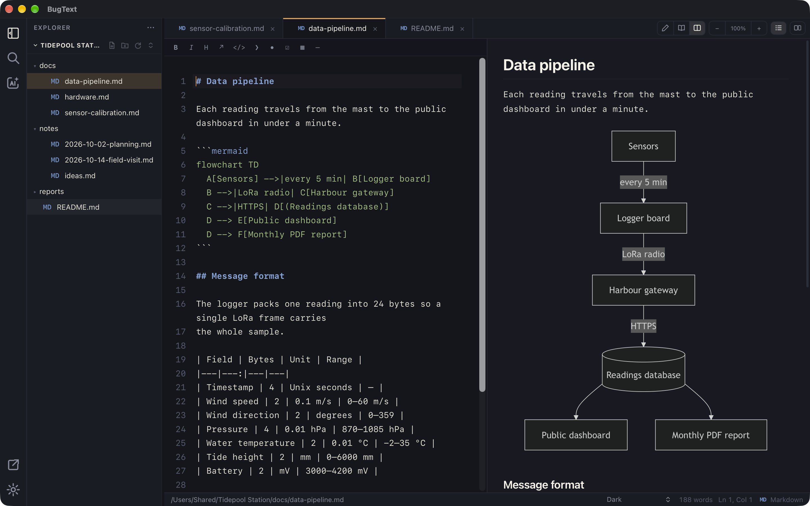

# BugText

A fast, lightweight markdown editor built with Tauri 2 + Rust and a plain-TypeScript
frontend. BugText is an IDE-style workspace for markdown: a file explorer, split
windows, a command palette, rich preview (mermaid, math, raw HTML), a built-in AI
panel, a PDF reader, and document export.

**License:** MIT · **Identifier:** `com.kael.bugtext`

> Clean-room, independent project. Written from scratch; not derived from any
> GPL-licensed editor.



## Features

- **Editor** — CodeMirror 6 with markdown highlighting, soft-wrap, line numbers, and
  per-document undo. Markdown tabs include a formatting toolbar; standalone HTML
  tabs use proper HTML syntax highlighting. Live preview has a 300 ms debounce.
- **Workspace shell** — activity bar, toggleable file explorer with full CRUD
  (create, rename, duplicate, delete-to-trash, reveal in Finder), and resizable panels.
- **Native multi-window** — create independent macOS windows from View or the Dock;
  each has its own tabs, Explorer workspace, AI panel, and optional Main/Sub split.
- **Main/Sub split** — each native window can show Main and Sub document panes with
  independent tabs and type-aware view modes.
- **Tabs** — multi-document tabs with dirty markers, pinning, and right-click actions
  (split, move between windows, close variants, copy paths).
- **Command palette** — `⌘K` to fuzzy-find files or run commands.
- **Search** — in-editor find (`⌘F`) and **Find in Folder** (`⌘⇧F`): content search
  across text files and PDFs, with results grouped by file (click to open at the line).
- **Customizable keyboard shortcuts** — the **Shortcuts** settings page (or **View →
  Keyboard Shortcuts**) lists every command; rebind, reset, or restore defaults.
- **Finder drag/drop** — open files by dropping onto a document pane, copy them
  into Explorer folders/file locations, or drop onto the AI panel to attach them.
- **Compare** — select two files and view a side-by-side diff.
- **Recovery & version history** — unsaved edits are continuously drafted in the
  background and offered back after a crash or quit (restore / discard banner on
  launch), without changing the explicit-save model. BugText detects when an open file
  changes on disk (reload when clean, conflict prompt when dirty, overwrite
  protection on save) and keeps per-file local snapshots on save plus manual
  snapshots, browsable in a version-history panel with Compare and Restore.
- **Rich preview** — [mermaid](https://mermaid.js.org) diagrams, [KaTeX](https://katex.org)
  math (`$…$`, `$$…$$`), and raw HTML. Standalone HTML previews measure their
  rendered content so wide documents scroll in the preview pane without trapping
  overflow inside the iframe.
- **PDF reader & editor** — open `.pdf` files rendered with pdf.js, with fit-to-width
  reset, zoom, horizontal wheel navigation, and Space/middle-mouse panning for enlarged
  pages while preserving text selection and find. An edit toolbar adds text boxes,
  cover boxes (color / opacity), and selection edits — either a visual overlay (Edit
  Text) or a real in-document rewrite (Direct) via pdf-lib — plus per-page OCR
  (tesseract.js, configurable language such as `eng` or `eng+vie`) for scanned pages.
  Edits draft locally until saved; the original is backed up to a hidden
  `.bugtext-pdf-backups/` folder before Save. Text the standard PDF fonts cannot
  encode (Vietnamese, CJK, symbols) is saved with a matching macOS system font, and
  edits on rotated or cropped pages land where they were placed.
- **AI panel** — a right-side Chat assistant. Pick an engine per feature: a local CLI
  (Claude Code, Codex CLI, Pi) or an API connection (Anthropic, OpenAI, OpenRouter,
  or any OpenAI- or Anthropic-compatible server such as Ollama or LM Studio), with its
  model and effort. The open note is always context; with a folder open, keyword
  retrieval adds the most relevant passages from the workspace. Attach files via 📎,
  drag-drop or `@`-mention. Replies show timing, model and source links, with Copy,
  Insert at cursor, Replace selection (reviewed as a diff against the original
  source) and Save as new note. Context is capped by **Max context characters**.
- **Sandboxed coding agents** — on macOS every CLI run uses a Seatbelt sandbox
  confined to the open folder; without a folder (and always for Pi) runs are
  answer-only. Dirty tabs get Recovery snapshots first, and a changed-files card lists
  what the agent added, modified or deleted afterward.
- **AI quick actions** — Proofread / Rewrite / Summarize / Generate outline from the
  command palette (`⌘K`) or the editor right-click menu, acting on the selection (or
  the whole document). Proofread and Rewrite replace text through the diff review;
  Summarize and Generate outline stream into Chat. Each action has its own engine in
  **Settings ▸ AI ▸ Use for** and is hidden when switched off. CLI quick actions never
  get folder access.
- **MCP server** — off by default. When enabled in **Settings ▸ AI ▸ MCP server**,
  terminal agents such as Claude Code and Codex can list, read, search, create and
  edit notes in BugText's open folders and read the current selection; every edit is
  snapshotted first.
- **Settings** — a full-window screen (`⌘,` or **BugText → Settings…**) with General,
  Editing, Theme, Shortcuts and AI pages and a search box, plus raw `settings.json` /
  `agent.json` for advanced edits. Changes apply live and sync across windows. General
  includes an app-icon picker that sets the Dock icon.
- **Updates** — manual checks from Help and optional once-daily automatic checks;
  installation always requires confirmation.
- **Themes** — System, Light, Dark, Catppuccin Mocha, Everforest Dark, Nord — recoloring
  the whole UI including editor syntax.
- **Export** — Markdown and plain-text documents export to PDF and DOCX via pandoc
  (+ typst for PDF), with math and Mermaid rendered first, and to PNG / SVG images of
  the preview. HTML documents export to PNG / SVG.
- **Zoom** — editor, HTML preview, and PDF preview zoom in / out, persisted where
  applicable.

## Requirements

- **Node.js** and **Rust** (stable) with the Tauri 2 prerequisites for your platform.
- **Export only:** [pandoc](https://pandoc.org) and [typst](https://typst.app) —
  install with `brew install pandoc typst`. They are located at runtime, not bundled.
- **AI (optional):** an API key for Anthropic, OpenAI or OpenRouter, a local
  OpenAI-compatible server (e.g. [Ollama](https://ollama.com) or LM Studio), and/or a
  coding CLI (Claude Code, Codex CLI, Pi). BugText resolves your login-shell `PATH` to
  find CLIs installed via Homebrew, npm, etc.

## Getting started

```bash
npm install
npm approve-scripts esbuild fsevents   # one-time: allow native postinstalls
npm run tauri dev                      # run the desktop app (hot reload)
```

### Build a release bundle

```bash
npm run tauri build
```

### Tests & checks

```bash
npm run test                 # Vitest unit tests (pure functions)
npm run build                # type-check + Vite production build
cd src-tauri && cargo test   # Rust unit tests
cd src-tauri && cargo check  # fast backend compile-check
```

## Configuring the AI panel

Set up AI in **Settings ▸ AI**: **Use for** picks the engine, model and effort for
Chat and each quick action (and switches them on or off), **Local CLI** detects
Claude Code, Codex CLI and Pi (including Claude accounts and custom paths), and
**API providers** adds connections from presets, discovers their models and tests
them. Connection addresses must use HTTPS, except loopback HTTP for local servers.

The same settings live in `agent.json` (version 2) in the app config directory; open
it from **Settings ▸ General ▸ Open agent.json**. Its top-level keys are
`connections`, `enabled`, `uses` (one engine/model/effort row per feature),
`localCli`, and `maxContextChars` (120,000 characters by default, roughly 30,000
tokens). Older `ai.json` / version 1 files migrate automatically, keeping an
`agent.v1.json` backup.

> **Security note:** API keys are stored in your macOS Keychain under service
> `com.kael.bugtext`, never in `agent.json`.

## Architecture

Tauri 2 + Rust native shell; plain-TypeScript frontend (no framework) wired by a thin
`main.ts`, with one responsibility per file. Pure logic (fuzzy match, settings parsing,
diff, provider request/parse, PDF geometry) is unit-tested, along with UI behavior on
a small DOM fixture; streaming and binary-export paths are manually smoke-tested.

```
src/
  main.ts          bootstrap + wiring + hotkeys + preview debounce
  editor.ts        CodeMirror 6 (multi-document, selection/replace API)
  markdown-format.ts pure Markdown toolbar transformations
  preview.ts       markdown-it pipeline (+ KaTeX rule, raw HTML)
  render-extras.ts mermaid + KaTeX post-processing
  windowview.ts    per-window component (tabs, toolbar, panes, status)
  explorer.ts      file tree + context menus + CRUD
  palette.ts       ⌘K command/file overlay
  search.ts        Find in Folder results panel
  keymap.ts        shortcut registry + accelerator match/format
  settings-screen/ full-window settings screen (pages, search registry, app icons)
  settings-sync.ts cross-window settings change event
  settings.ts      settings.json model (themes, fonts, sizes, session, keymap)
  updater.ts       manual and once-daily signed update checks
  compareview.ts   side-by-side diff surface
  pdfview.ts       pdf.js viewer + edit toolbar
  pdf-edit-document.ts   PDF edit operation model (parse/serialize/draft)
  pdf-edit-writer.ts     applies edits to the PDF via pdf-lib
  pdf-edit-capabilities.ts  per-page edit-capability classification
  pdf-selection-edit.ts  selection-to-edit geometry helpers
  pdf-direct-rewrite.ts  in-document text rewrite path
  pdf-page-frame.ts      editor-to-PDF coordinates (crop box + rotation)
  pdf-unicode-fonts.ts   system-font fallback for non-WinAnsi text
  pdf-ocr.ts       per-page OCR via tesseract.js
  recovery-policy.ts pure recovery decisions (ids, conflict, retention)
  recovery.ts      draft autosave, crash restore, external-change detection, snapshots
  historyview.ts   version-history panel (list / compare / restore)
  hash.ts          shared deterministic text hash (recovery + AI edit binding)
  ai/              AI panel: settings (agent.json v2), engines, connections, CLI
                   runner, retrieval, quick actions, diff review, panel
  mcp/             MCP tool handlers on the webview side
src-tauri/src/
  lib.rs           Tauri builder: command registry + plugins
  files.rs         file IPC, settings/ai-settings files, recursive walk
  recovery.rs      atomic draft/snapshot store + file_stat
  ai.rs            typed CLI runs (ai_run), streaming, cancellation
  cli_args.rs      CLI argument builder; cli_scan.rs detects installed CLIs
  sandbox.rs       macOS Seatbelt profile for CLI runs
  mcp_*.rs         MCP stdio bridge, socket server, path confinement, client setup
  secrets.rs       API keys in the OS keychain (keyring crate)
  export.rs        pandoc/typst export
  menu.rs          native menu bar
  native_windows.rs independent Tauri window creation and focused-window routing
  macos_dock.rs     macOS Dock context-menu New Window integration
  dock_icon.rs      runtime Dock icon from the Settings icon picker
```

## Signed updates

`src-tauri/tauri.conf.json` points the updater at the GitHub release feed
(`latest.json`) and holds the public key. Release builds in CI sign the updater
artifacts with the matching private key, which lives only in CI secrets; local
builds without it should pass `--config '{"bundle":{"createUpdaterArtifacts":false}}'`.
Settings ▸ General offers Manual or Automatic (at most once a day) checks, and
installing always asks first.

## License

MIT — see [LICENSE](LICENSE). Bundled third-party libraries are listed in
[THIRD-PARTY-NOTICES](THIRD-PARTY-NOTICES).
