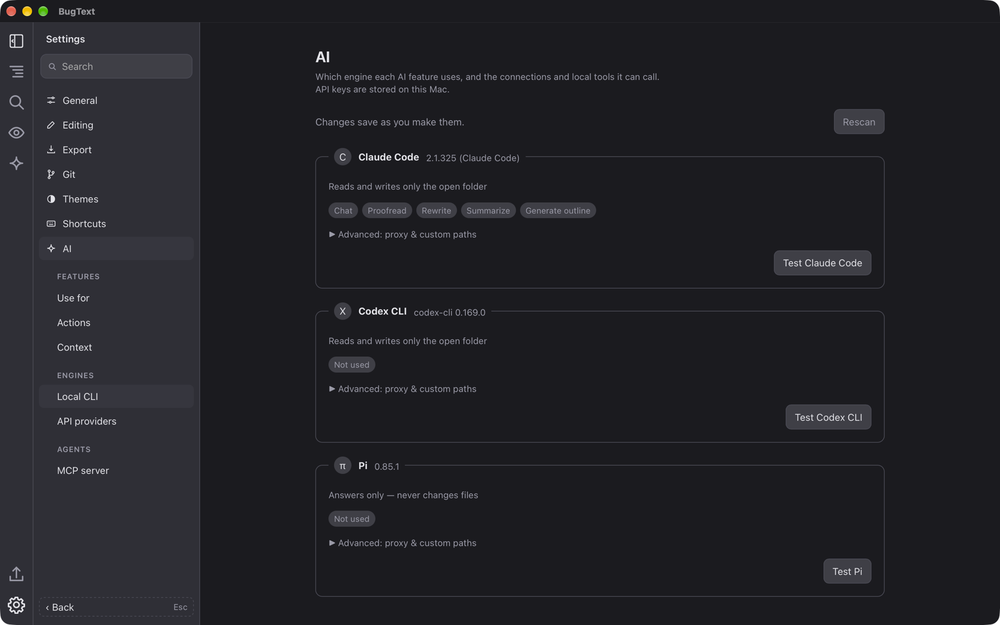
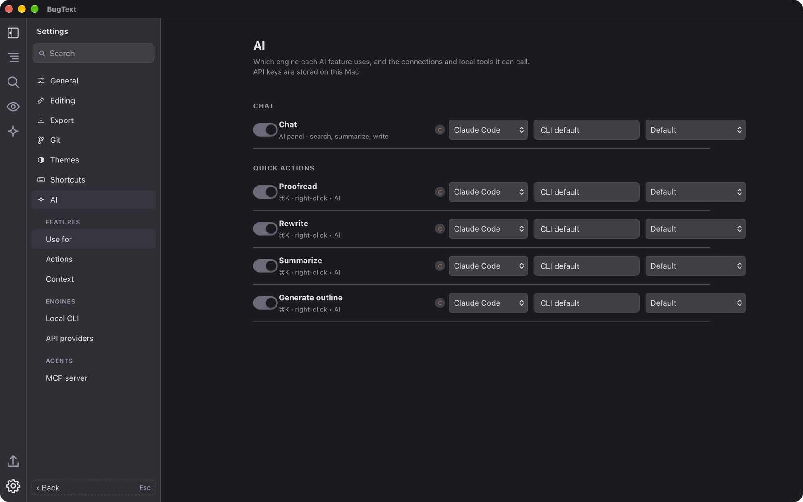

BugText does not come with its own AI. You connect what you already have: a coding CLI such as Claude Code, Codex CLI or Pi on your Mac, or an API connection to Anthropic, OpenAI or any OpenAI-compatible server, including one running on your own Mac. Then you choose which engine does which job.

## When to use it

- Before you use Chat, quick actions or recipes for the first time.
- When you want a cheaper or faster model for small jobs and a stronger one for big ones.
- When you want everything to stay on your Mac with a local model.

## How to use it

Open Settings (<kbd>⌘</kbd> <kbd>,</kbd>) ▸ **AI**.

### A coding CLI

**Local CLI** lists the Claude Code, Codex CLI and Pi installs BugText found. Sign in to the CLI in Terminal as you normally would; BugText uses that sign-in. When a CLI works in your folder, macOS sandboxes it to that folder.

### An API connection

1. Go to **API providers** and click **Add Connection…**. **Quick fill** sets up a known provider, or type a **Name** and **Server address** for Anthropic or any OpenAI-compatible server.
2. Paste the API key. It is stored in the macOS Keychain.
3. BugText lists the models the server offers; pick a **Text model**. Click **Test Connection** to check.

Addresses must use `https`, except a server on this Mac (`localhost`), so a local model server works without a certificate.

### Choose what each feature uses

**Use for** has a row for **Chat** and for each quick action (Proofread, Rewrite, Summarize, Generate outline). For each, pick the engine, the model and the effort, or switch the feature off.

### Control what is sent

**Context** sets **Folder search excerpts** (how many passages a chat may add), **Maximum context characters**, **Include superseded notes**, and **Never send to AI** patterns for files that must never be sent, such as `private/**`.

## What it will not do

- API keys never go into BugText's settings files or logs; they stay in the Keychain.
- With no folder open, a coding CLI can only answer, not change files.
- Never send to AI patterns stop BugText from sending those files. A coding CLI with access to the folder could still open them itself.

## Next steps

- [Chat with your notes](chat.md)
- [Quick actions and recipes](actions-and-recipes.md)
- [Privacy](../reference/privacy.md)
