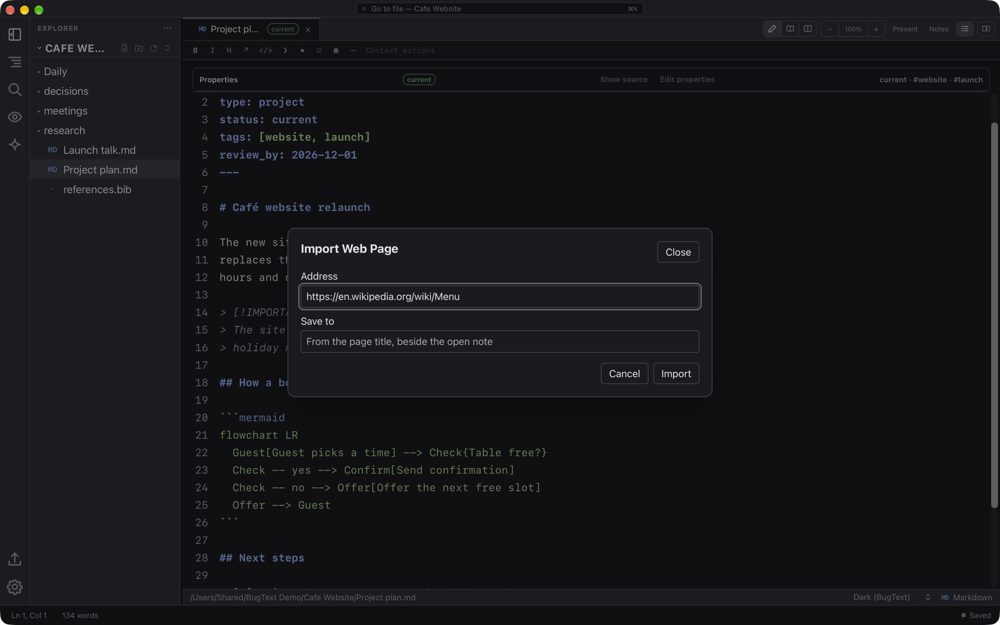

Import brings outside material into your folder as an ordinary Markdown note. The note records where it came from and when, so you can tell later whether the source has changed.

## When to use it

- You want to keep an article or a manual page as a clean, searchable note.
- Someone sent you a Word document and you want to work on it as Markdown.
- You have a small spreadsheet export that belongs in a note as a table.

## How to use it

1. Open the folder the note should go in.
2. Choose **File** ▸ **Import** and then **Web Page…**, **Word Document…** or **CSV…** (also in <kbd>⌘</kbd> <kbd>K</kbd>).
3. Paste the web address, or choose the file.
4. BugText converts it and opens the new note. A result sheet shows what was kept, such as how many images and tables came through.

Every imported note gets three properties: `source` (the address or file), `imported_at` (when) and `source_digest` (a fingerprint of the original).

### What each kind keeps

- **Web page**: the article text, headings, lists, links and tables. Scripts, menus and page chrome are removed. A table whose cells hold paragraphs or lists becomes plain paragraphs. Images stay linked to the web.
- **Word document**: text, headings, lists and tables. Images are copied into the note's images folder. The original `.docx` is copied to `originals` inside the images folder and linked from the note.
- **CSV**: up to 500 rows and 50 columns become a Markdown table. The original file is copied to `originals` and linked from the note.

If you import the same address or file again, BugText offers to open the note you made last time instead of making a second one.

While an import runs, **Cancel** (or Esc) stops it and no note is created. A conversion that takes longer than a minute is stopped.

> [!NOTE]
> Web pages and Word documents are converted with Pandoc: `brew install pandoc`. Word documents need Pandoc 3.1.6 or later. CSV needs nothing extra.

## What it will not do

- It fetches only `https` addresses on the public internet. Addresses on your own Mac or local network, and redirects to them, are refused.
- It does not import pages over 5 MB, or PDFs (open a PDF directly instead).
- It never overwrites an existing note: a second import of the same name gets a new file name.

## Next steps

- [Keep a web page as a note](../recipes/keep-a-web-page.md)
- [Capture while reading](../reading/capture.md)
