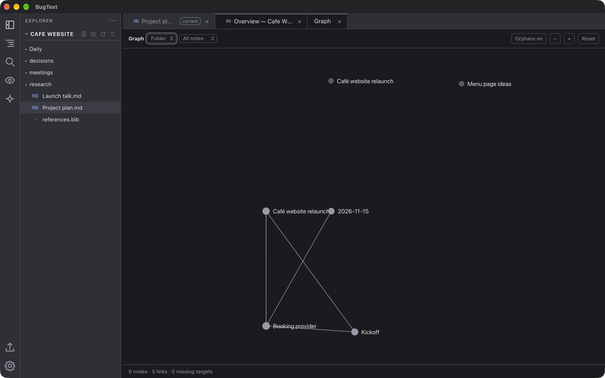

Notes are more useful when they point at each other. BugText links notes with plain Markdown links, shows what links back, finds mentions you have not linked yet, and keeps links working when you rename or move a note.

## When to use it

- You want to connect a meeting note to the project it belongs to.
- You want to see every note that mentions a decision.
- You want a picture of how a folder of notes hangs together.

## How to use it

### Link to a note

- **Edit** ▸ **Insert Link to Note…** (<kbd>⌘</kbd> <kbd>⌥</kbd> <kbd>L</kbd>) lets you pick a note, and optionally a heading inside it, by typing part of its name.
- Or type `](` after link text: BugText suggests notes, then headings after `#`.
- Click a link in the preview, or <kbd>⌘</kbd>-click it in the editor, to open it. Hover over a note link to see a short preview.

### The Links panel

**View** ▸ **Links** (<kbd>⌘</kbd> <kbd>⌥</kbd> <kbd>⇧</kbd> <kbd>O</kbd>) sits beside the Outline and shows, for the open note:

- **Linked from**: notes that link here, with the text around each link.
- **In this note**: the links this note makes. **Broken** lists the ones whose target does not exist.
- **Unlinked mentions**: notes that mention this note's title without linking to it. Click **Link** to turn a mention into a link, or **Skip**.

### Rename without breaking links

When you rename or move a note in the Explorer, an **Update links?** sheet lists every link that would break. Tick the ones to fix and apply. Open notes change as one undo step; closed notes get a Recovery snapshot first. Settings ▸ Editing ▸ Links controls suggestions and this review.

### Bookmarks

- **Add Bookmark** (<kbd>⌘</kbd> <kbd>⌥</kbd> <kbd>B</kbd>) remembers the current note and line.
- **Show Bookmarks** (<kbd>⌘</kbd> <kbd>⌥</kbd> <kbd>⇧</kbd> <kbd>B</kbd>) lists them for this folder. A bookmark whose note has gone shows as missing instead of opening the wrong thing.

### Graph

From <kbd>⌘</kbd> <kbd>K</kbd>:

- **Graph: Open Local Graph** shows the open note with its links and backlinks, one or two steps out.
- **Graph: Open Folder Graph** shows the whole folder, up to its 500 most-linked notes. Filter by folder, show orphans (notes with no links) and missing targets.

Click a note to open it. Arrow keys move between notes, and the wheel zooms.

## What it will not do

- Links are ordinary Markdown links to file paths, so they work in any other Markdown app too.
- Unlinked mentions and link updates never change a note until you review and apply them.

## Next steps

- [Properties, tasks and status](properties-and-tasks.md)
- [Search and replace](search-and-replace.md)
