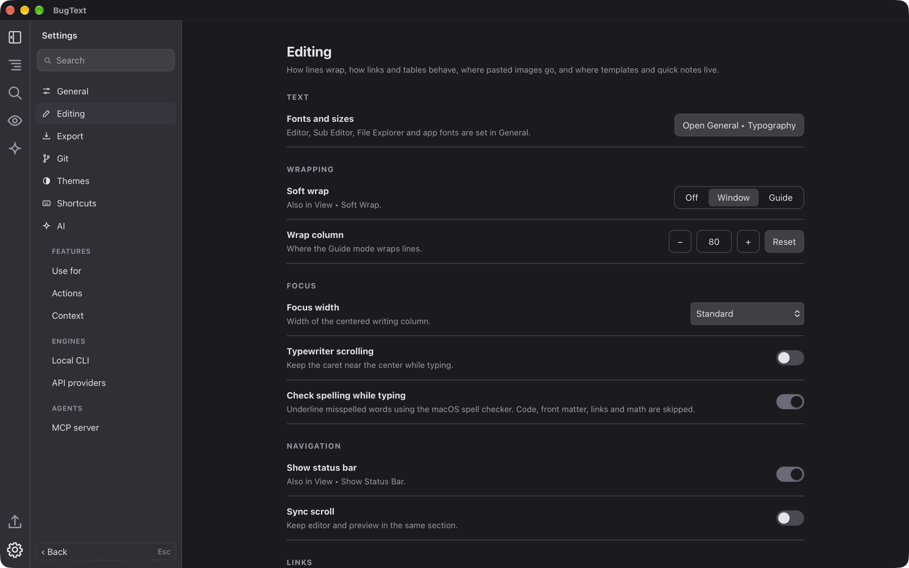

Settings fills the window with seven pages. Open it with <kbd>⌘</kbd> <kbd>,</kbd>, **BugText** ▸ **Settings…** or the gear in the activity bar. The search box at the top jumps to any setting. Changes apply at once, in every window.

Leave with <kbd>Esc</kbd>, <kbd>⌘</kbd> <kbd>[</kbd>, the Back button or <kbd>⌘</kbd> <kbd>,</kbd> again. Your tabs, unsaved text and split are exactly as you left them.

## When to use it

- When you want to change how BugText looks, edits, exports or uses AI.

## How to use it

### General

- **Typography**: a size and font for the app, File Explorer, Editor and Sub Editor. **Custom…** takes any installed font.
- **Show Hidden Files**: show or hide names starting with a dot.
- The app icon picker, which changes the Dock icon.
- **Performance**: **Large folders** refreshes big folders less often.
- **Review queue**: turn change tracking on or off. See [Review queue](../reading/review-queue.md).
- **Session**: **Reopen workspace windows** at launch, and **Manage workspaces**.
- **Updates**: Manual, or Automatic (at most once a day).
- **Settings files**: open `settings.json` or `agent.json` as text.

### Editing

- **Text** and **Wrapping**: line numbers, soft wrap and the page guide.
- **Focus**: **Focus width**, **Typewriter scrolling**, **Check spelling while typing**.
- **Navigation**: **Show status bar**, **Sync scroll**.
- **Links**: **Preview links on hover**, **Suggest notes while typing links**, and what happens **When renaming or moving notes**.
- **Tasks**: **Add completion date** when you tick a task.
- **Tables**: format tables while editing, and paste spreadsheet cells as a table.
- **Images**: the image folder, how pasted images are named, and whether dropped images are copied and linked or opened.
- **Templates**: the templates folder, the default folder for new notes, the date format, and where quick notes go.

### Export

- **Tools**: which Pandoc and Typst BugText found, with **Check Now**.
- **Citations**: **Citation style** (Chicago author-date, APA or IEEE).
- **Presets**: make and edit export presets — page size, margins and numbers, body font, size and spacing, title block, and table of contents.

### Git

**Git path** and **Git version** show which Git BugText uses. **Show Source Control** shows or hides the panel.

### Themes

**Appearance** picks System, Light or Dark, and a colour theme: Catppuccin, Dracula, Everforest, GitHub Light, Gruvbox, Monokai, Nord, One Dark and One Light, Solarized, Tokyo Night and others. **Left Sidebar Appearance** matches the panel, tints it or keeps the default. The theme menu in the status bar switches quickly.

### Shortcuts

Every command with its shortcut, by category. Click one to record a new key, reset it, or **Restore Defaults**. Also at **View** ▸ **Keyboard Shortcuts…**. See [Keyboard shortcuts](keyboard-shortcuts.md).

### AI

- **Use for**: the engine, model and effort for Chat and each quick action.
- **Actions**: your saved actions and recipes.
- **Context**: folder search excerpts, maximum context, superseded notes, and **Never send to AI** patterns.
- **Local CLI**: the coding CLIs BugText found.
- **API providers**: your API connections.
- **MCP server**: let terminal agents connect.

See [Set up AI](../ai/set-up-ai.md).

## What it will not do

- Settings never closes your tabs or discards unsaved text.
- API keys are not shown in, or saved to, any settings file.

## Next steps

- [Keyboard shortcuts](keyboard-shortcuts.md)
- [Set up AI](../ai/set-up-ai.md)
