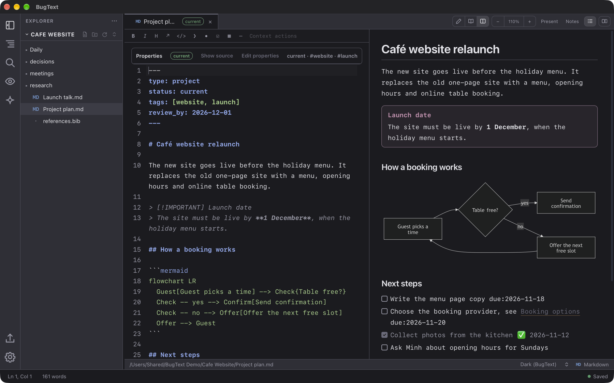

BugText is a Mac app for working with a folder of plain files. You write Markdown notes with a live preview beside them, read and mark up PDFs, edit code and config files, and ask AI about any of it. Everything stays as ordinary files on your Mac, so other apps, Git and AI agents can use the same folder.

## When to use it

- You keep notes, plans or documentation as Markdown files and want a fast editor with a good preview.
- You read PDFs and web pages and want to keep what matters as linked notes.
- You let AI agents such as Claude Code or Codex work in your notes and want to see exactly what they changed.
- You need to fix a PDF (a typo, a covered line, a page order) without another app.

## How to use it

BugText is organised around one open folder per window:

- **Explorer** on the left lists the folder's files. <kbd>⌘</kbd> <kbd>B</kbd> shows or hides it.
- **Main** and an optional **Sub** pane hold your open tabs, each with its own view mode: editor, reading view, or editor with preview beside it.
- **Side panels** open on demand: Outline, Links, Filter, Review, Source Control and the AI chat.
- **Command palette** (<kbd>⌘</kbd> <kbd>K</kbd>) opens any file or runs any command by name.
- **Status bar** at the bottom shows the cursor, word count, reading time and save state.

What each area of the guide covers:

- **Write**: the editor, diagrams and callouts, templates, focus mode, presenting and exporting.
- **Notes and folders**: windows and workspaces, search, links, properties and tasks, importing, history and Git.
- **Read and review**: saving excerpts while reading, and reviewing notes that changed behind your back.
- **PDFs**: reading, highlighting, editing and reorganising PDFs.
- **AI**: setting up engines, chatting with your notes, one-step actions, recipes, and connecting agents.

> [!TIP]
> If you only try one thing, open a folder of notes and press <kbd>⌘</kbd> <kbd>K</kbd>. Typing part of any file name or command finds it.

## What it will not do

- BugText never saves a file you did not ask it to save. Unsaved work is kept as recovery drafts outside your files until you save or discard it.
- It has no account, no cloud of its own and no telemetry. See [Privacy](../reference/privacy.md).
- AI never changes a note without showing you the change first, and coding agents run sandboxed to the open folder.

## Next steps

- [Install BugText](install.md)
- [Your first five minutes](first-five-minutes.md)
- [Editor basics](../writing/editor-basics.md)
