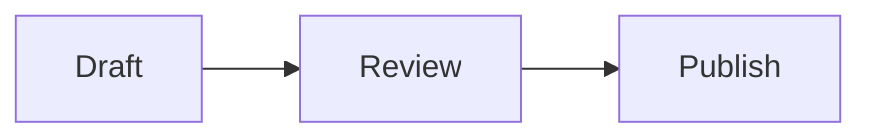

Beyond plain Markdown, the preview draws diagrams, math, callouts and footnotes, so a note can carry a whole design or report.

## When to use it

- You want a flowchart, sequence or timeline inside a note, written as text.
- You want a highlighted warning or tip, numbered footnotes, or formulas.

## How to use it

### Mermaid diagrams

Write the diagram in a fenced code block marked `mermaid`:

````markdown

````

Hover over a diagram for **Zoom out**, **Zoom in**, **Fit**, **Fullscreen**, **PNG** and **SVG**. PNG copies a picture; SVG copies the diagram's SVG text. Fullscreen covers the note: scroll to zoom, drag to pan, and press <kbd>Esc</kbd> to return.

If a diagram has a mistake, the preview shows the error and a **Show source** toggle. **Fix with AI** sends only that diagram's source to AI and shows the corrected version as a change for you to accept or reject.

### Callouts

Start a quote with `[!NOTE]`, `[!TIP]`, `[!IMPORTANT]`, `[!WARNING]` or `[!CAUTION]`. Add a title after the marker, or leave it out for the default label:

```markdown
> [!WARNING] Before you sync
> Save your changes first.
```

### Footnotes

Write `[^source]` where the note goes and `[^source]: The details.` on its own line. The preview numbers them, lists them at the end, and links both ways.

### Math

Write inline math between single dollar signs, `$E = mc^2$`, and a block between double dollar signs.

### Code blocks

Fenced code blocks are highlighted. Hover over one for **Copy**.

### Note links

A Markdown link to another note's file opens that note when clicked in the preview. Hover over one to see a short preview of the note. See [Links, bookmarks and graph](../notes/links-and-graph.md).

## What it will not do

- The preview never runs scripts from a note. Raw HTML in Markdown is cleaned before it is shown.
- Exports and presentations show diagrams and callouts, but not the hover buttons.

## Next steps

- [Present a note](present.md)
- [Export and citations](export.md)
