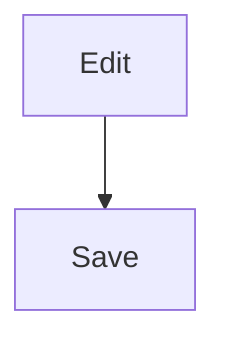

# Reading pack

Callouts, footnotes, code copy, Mermaid controls and fixes, and Unicode retrieval
(spec 1.1–1.6). Run in the release app on the second display. These checks are
waiting for the owner; automated tests do not establish webview behavior.

Pre-req: a folder open, Main/Sub panes available, a Rewrite engine configured for
AI checks, and Pandoc/Typst installed for PDF/Word export. Use this note in split
view, so edits can be made while observing the preview:

````markdown
# Reading pack sample

> [!NOTE]
> A labelled note.

> [!warning] Save **first**
> Check your changes.

> [!TIP]
> A tip.

> [!IMPORTANT]
> An important point.

> [!CAUTION]
> Take care.

Alpha[^a] beta[^b] again[^a].

```js
const a = 1 < 2;
```



```mermaid
nonsense <b>x</b>
```

[^a]: First note.
[^b]: Second note.
````

### READ-01 — Callouts (1.1)

- Steps: Read the sample in the Light and Dark themes. Add a title-only `> [!NOTE]`, an unknown `> [!FOO]`, and a marker after a quote's first line. Add an outer ordinary quote containing a nested quote whose first line is `[!NOTE]`.
- Expected: Five labelled boxes with thin full borders and readable titles/body in both themes. The custom title renders bold inline text; the title-only callout has no empty body. Unknown and later-line markers remain ordinary quote text; only the marked nested quote becomes a callout. No error or unexpected formatting.
- Status: [ ]  Notes:

### READ-02 — Footnotes (1.2)

- Steps: Click references 1 and 2, each return arrow, and the second reference to note 1. Add `Lonely[^missing].` with no definition. Add a definition containing `<script>alert(1)</script>`.
- Expected: Numbered references link to two notes; both references to note 1 share one item and have return links. Jumps stay inside the note, with no link-opening dialog. The missing reference remains literal text. No script or handler executes.
- Status: [ ]  Notes:

### READ-03 — Copy code (1.3)

- Steps: Hover over or keyboard-focus the JavaScript block's Copy button, click it, and paste into a plain-text editor. Repeat rapidly; try with long lines that scroll horizontally.
- Expected: Exact code text (`const a = 1 < 2;` plus its trailing newline), without the button label. Copied briefly replaces Copy, then resets after 1.5 seconds; repeated clicks restart feedback. The button stays at the block's top right. A clipboard refusal says Copy failed. Mermaid source gets no ordinary code-copy button.
- Status: [ ]  Notes:

### READ-04 — Mermaid controls and fullscreen (1.4)

- Steps: Hover over the valid diagram; use −, + and Fit. Open Fullscreen, zoom with the wheel, pan by dragging, and use its Fit. While fullscreen is open, edit the source in the other pane so the preview re-renders. Close with Esc; reopen and close with Close. Try in Main and Sub, on the second display.
- Expected: Hover/focus reveals the labelled toolbar. Inline zoom changes in steps; Fit resets it. Fullscreen stays inside its own note pane and continues working on its copy after the source preview changes. Only one overlay per note pane. Esc closes only the overlay and retains Reading mode; focus returns to its opener when still present. No opening animation with reduced motion enabled.
- Status: [ ]  Notes:

### READ-04B — Copy as PNG in the real webview (Task 5 Step 9)

- Steps: In the real app, click PNG on a valid diagram and use Preview.app → File → New from Clipboard. Repeat after zooming in. Try a diagram with a side over 16,384 pixels at the default 2× output scale. If checking dev separately, launch using `! npm run tauri dev`.
- Expected: A complete diagram image on a white background, unaffected by inline zoom. Oversize copy shows “The diagram is too large to copy as an image.” A refused clipboard write shows “Could not copy the image.” Nothing fails silently. Record the actual paste outcome and any error.
- Status: [ ]  Notes: Apply the native clipboard fallback only if the owner reports paste failure.

### READ-04C — Copy as SVG (1.4)

- Steps: Click SVG after inline zoom, paste into a text editor and open the saved SVG.
- Expected: SVG markup includes its SVG namespace, opens as a complete diagram and does not retain the inline percentage zoom. Copy success/failure is visible.
- Status: [ ]  Notes:

### READ-05 — Error card and Fix with AI (1.5)

- Steps: Expand and collapse Show source on the broken diagram. With Rewrite enabled and an engine available, click Fix with AI. Review the response, including a response wrapped in a code fence if produced; apply the diff and undo it once. Also type into the note while a request is running, then try applying the returned diff.
- Expected: First error line only; source is literal text, including `<b>x</b>`, with no HTML formatting. Source toggle has correct expanded state. AI input is only this diagram, with the parser error as quoted data. The diff proposes edits inside the fences; wrapping reply fences are removed. Surrounding note and fences remain intact. Apply uses the normal dirty/undo path; a note changed after sending refuses the stale diff.
- Status: [ ]  Notes:

### READ-05B — Fix hidden without an engine

- Steps: Disable Rewrite or configure no available Rewrite engine, then re-render the broken diagram's preview.
- Expected: Error and source toggle remain; Fix with AI is absent.
- Status: [ ]  Notes:

### READ-05C — Fix against a stale preview

- Steps: With the broken diagram's card visible, change its body or insert lines above its opening fence, then immediately click the old Fix with AI button before the debounced preview updates.
- Expected: “The diagram changed. Wait for the preview to update, then try again.” No AI request and no replacement of another block.
- Status: [ ]  Notes:

### READ-05D — Empty diagram safety

- Steps: Render an empty Mermaid fence, then one containing spaces/tabs only, with an engine available. Also clear a previously failed diagram's body and immediately click its old Fix with AI button before the preview updates.
- Expected: Empty/whitespace cards have no Fix with AI button. A stale button after the body changes shows “The diagram changed. Wait for the preview to update, then try again.” If an unchanged empty body reaches the handler, it shows “This diagram is empty. Add diagram source first.” No AI request or whole-note edit occurs.
- Status: [ ]  Notes:

### READ-06 — Unicode folder search for AI context (1.6)

- Steps: Save one note with `Tài liệu thiết kế đồng bộ. Tiếng Việt và đường.` and another unrelated English note. With Folder search context on, ask using `thiet ke dong bo`, `thiết kế`, NFD/decomposed `tiếng` (copy `tiếng`), and `duong`. Inspect Context sent. Try a query containing only `… — !!`.
- Expected: Accented and accent-free variants retrieve the Vietnamese note; composed/decomposed accents match, and `đường` matches `duong`. Punctuation-only query adds no retrieval matches and does not throw. This checks the AI context retrieval index, not the separate literal Find in Folder panel.
- Status: [ ]  Notes:

### READ-07 — PDF and DOCX export

- Steps: Export the sample containing callouts, footnotes, code and a valid diagram to PDF and Word. Open both exported files and inspect each page. Also capture a note as PNG/SVG.
- Expected: PDF/Word callouts are ordinary quotes with bold labels. Notes and the diagram remain readable; footnote numbers and text remain, without clickable footnote links or return arrows. No copy buttons, diagram toolbar or interactive error card is exported. Image captures retain the coloured callout boxes.
- Status: [ ]  Notes:

### READ-08 — Presentation isolation

- Steps: Present the sample note with a callout, footnotes, code, a valid diagram and a failed diagram.
- Expected: Callouts/notes/code render normally. No Copy button, Mermaid toolbar, fullscreen control, Show source toggle or Fix with AI card. A failed diagram remains the plain error message.
- Status: [ ]  Notes:


### READ-04D — Fullscreen lifecycle and keyboard focus (review item 8)

- Steps: Open Fullscreen. Tab and Shift+Tab through its controls, including wrapping in both directions; press Escape. Reopen, then switch tabs, close the active tab, hide the preview, and destroy the note pane/window in separate trials. Also type in the same note while fullscreen is open, and try switching away immediately after clicking Fullscreen while its module is loading.
- Expected: Keyboard focus stays inside the overlay. Escape still closes it. A different/closed tab, hidden preview or destroyed view closes the overlay and cannot reopen it from a pending import. Typing and re-rendering the same visible note leaves the clone working.
- Status: [ ]  Notes: Window lifecycle wiring has no isolated automated seam; this check remains with the owner.

### READ-05E — Nested fences and empty replies (review items 6–7)

- Steps: Try Fix with AI for an indented Mermaid fence inside a list item and for a quoted Mermaid fence. For a top-level diagram, test a reply with prose around a fenced diagram, then an empty or whitespace-only reply (including an empty fenced block).
- Expected: List/quote attempts show “Fix with AI works only on a diagram that is not inside a list or quote.” The first fenced diagram is extracted from a prose-wrapped reply. An empty result shows “The AI returned no diagram.” and does not open a diff.
- Status: [ ]  Notes:
